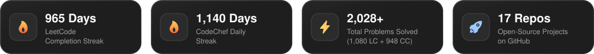
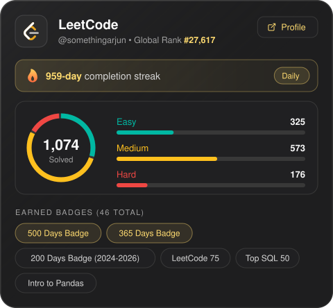
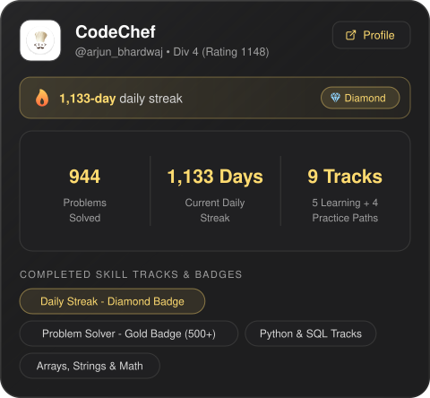
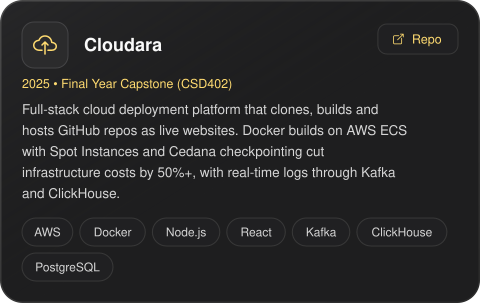
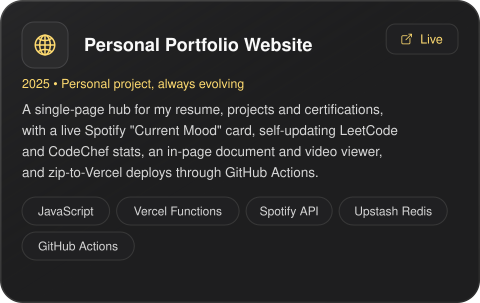
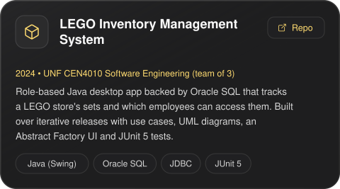
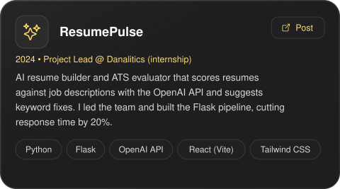
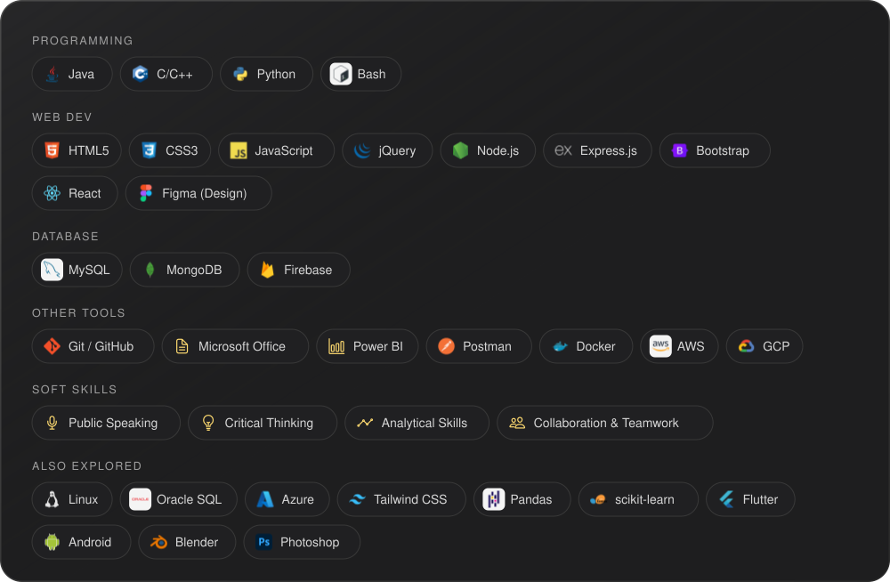
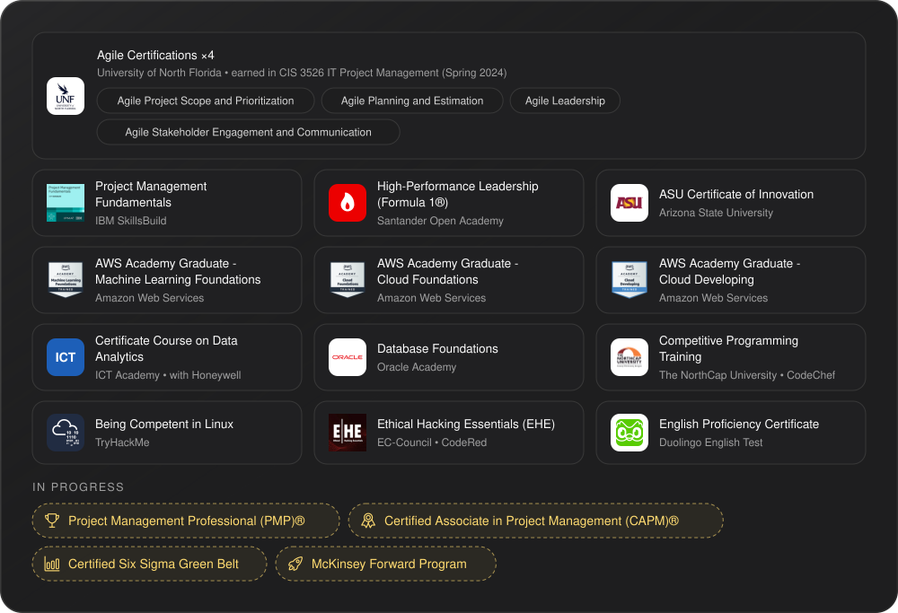

<!-- Profile README for github.com/master-coco, styled after https://somethingarjun.vercel.app -->

  

  
  
  
  

## 👋 Hello there... 🤗, I'm Arjun

A passionate project manager and full stack developer from India. As a Computer Science graduate specializing in **Full Stack Development**, with a strong foundation in **Project Management / TPgM**, I combine hands-on experience in scalable application development with a passion for building efficient, user-friendly platforms. My curiosity and leadership mindset drive me to turn complex ideas into robust, impactful solutions, whether it's leading a tech team or managing projects.

- 🤝 I'm working as a **Project Management Apprentice** at **Google**
- 🎓 I've **completed my degree in Computer Science Engineering**
- 🌱 I've majored in **Full Stack Development** and minored in **Project Management**
- 👨‍💻 My public projects are available in [my repositories](https://github.com/master-coco?tab=repositories)
- 📫 How to reach me: **arjun.bhard18@gmail.com**
- 📄 Know about my experiences by checking my [resume](https://somethingarjun.vercel.app/#resume) and [portfolio](https://somethingarjun.vercel.app/#portfolio)
- ⚡ Fun fact: **I'm an expert at not waiting to become an expert :)**

## 🚀 What I'm doing

<table>
  <tr>
    <td width="50%" valign="top">
      <h3>🎯 Project Management Apprentice at Google</h3>
      Part of the <b>YouTube Trust &amp; Safety</b> team under the <b>Global Vendor Operations (GVO)</b> organization, working on the YT-OOPS escalations team: driving cross-functional program execution, escalation management, vendor operations governance, SLA tracking and operational analytics dashboards.
    </td>
    <td width="50%" valign="top">
      <h3>💻 Coding</h3>
      With AI agents writing most of the code these days, I'm honestly not the best coder myself anymore, but the invention of the calculator didn't remove the need for the mathematician. I'm still big into solving DSA questions and forming the logic behind the solutions, with <b>950+ day LeetCode</b> and <b>1,100+ day CodeChef</b> streaks going strong.
    </td>
  </tr>
  <tr>
    <td width="50%" valign="top">
      <h3>🎙️ Anchoring and Event Coordination</h3>
      Recorded a video for the <b>G20 conference</b> on Crime and Security in the age of AI, NFTs and Metaverse, and hosted and anchored <b>10+ campus events</b> at The NorthCap University as part of the Student Activities &amp; Leadership Cell.
    </td>
    <td width="50%" valign="top">
      <h3>📚 Currently Learning</h3>
      Preparing for the <b>Project Management Professional (PMP)®</b> and <b>Certified Associate in Project Management (CAPM)®</b> exams and the <b>Certified Six Sigma Green Belt</b>, while taking part in the <b>McKinsey Forward Program</b>, and getting sharper at SQL and dashboards along the way.
    </td>
  </tr>
</table>

## 📊 Coding & Open-Source Stats

  

  
  

🟢 Live profile sync: these cards refresh every day from LeetCode and CodeChef

## 🛠️ Featured Projects

  
  

  
  

<b>More projects and coursework</b>

 

| Project | What it is | Links |
| --- | --- | --- |
| **AI & Machine Learning (CSL236)** | 13 end-to-end ML experiments in Python: preprocessing, encoding, feature selection, PCA, regression, KNN, Naive Bayes, SVM and decision trees | [Repo](https://github.com/master-coco/IAIML) |
| **Operating Systems (CSL303)** | CPU scheduling (FCFS, SJF, Priority, Round Robin), synchronization, Banker's algorithm, memory allocation and page replacement in Java | [Repo](https://github.com/master-coco/OperatingSystemPracticals) |
| **Expense Tracking REST API & NoSQL** | CRUD and aggregation API with Node.js, Express, Mongoose and MongoDB Atlas, tested in Postman, plus mongosh schema, indexing and aggregation work | [API](https://github.com/master-coco/expense-tracking-API-project) • [nsdb](https://github.com/master-coco/nsdb) |
| **Web Framework clones** | Responsive front-end builds for the Web Frameworks course | [Flipkart](https://master-coco.github.io/FlipkartClone/) • [HealthKart](https://master-coco.github.io/HealthKartClone/) • [Iconic India](https://master-coco.github.io/IconicIndiaClone/) • [GFG Sign-In](https://master-coco.github.io/GFGSignIn/) |
| **Statistics with Python (CSL530)** | Data visualization, descriptive statistics, probability and distributions, plus an end-to-end analysis project | [Repo](https://github.com/master-coco/CSL530-STATISTICS-WITH-PYTHON) |
| **Notice Board Management System** | My first Java project: a menu-driven CLI app with login and sign-up flows | [Repo](https://github.com/master-coco/FundamentalsOfComputerProgramming) |

## 🧰 Tech Stack

  

## 🏅 Certifications

  

<b>Verify my credentials</b>

 

- **AWS Academy Graduate - Machine Learning Foundations** · [Credly](https://www.credly.com/badges/84a6df1a-a753-425f-ad43-784163a9fc2c/public_url)
- **AWS Academy Graduate - Cloud Foundations** · [Credly](https://www.credly.com/badges/6864308d-e00e-4b4b-9300-cdda369ba994/public_url)
- **AWS Academy Graduate - Cloud Developing** · [Credly](https://www.credly.com/badges/770af4fc-f1b4-4caf-ab41-57a9cb4874c9/public_url)
- **Project Management Fundamentals** (IBM SkillsBuild) · [Credly](https://www.credly.com/badges/67f7e45f-8695-4582-8454-fb9b03afc24b/public_url)
- **Agile Certifications ×4** (University of North Florida) · [LinkedIn post](https://lnkd.in/p/dSZvSZrs)
- **High-Performance Leadership: Lessons from Formula 1®** (Santander Open Academy) · [LinkedIn post](https://lnkd.in/p/dAxBS9Rs)
- **ASU Certificate of Innovation** (Arizona State University) · [Credential](https://www.virtualbadge.io/certificate-validator?credential=550a8c76-918b-43a1-9a11-94dd9e37c43c)
- **Certificate Course on Data Analytics** (ICT Academy, with Honeywell) · [LinkedIn post](https://lnkd.in/p/d-BNhE-x)
- **Database Foundations** (Oracle Academy) · [LinkedIn post](https://lnkd.in/p/dt3zZsNX)
- **Competitive Programming Training and Certification** (The NorthCap University × CodeChef) · [LinkedIn post](https://lnkd.in/p/dMxw2ip3)
- **Being Competent in Linux** (TryHackMe) · [Credential](https://certx.in/certificate/0270772f-3809-4400-b29b-1e1c61cd09971164639)
- **Ethical Hacking Essentials (EHE)** (EC-Council CodeRed) · [LinkedIn post](https://lnkd.in/p/dCUryf6v)
- **English Proficiency Certificate** (Duolingo English Test) · [LinkedIn post](https://lnkd.in/p/dCEU2xXi)

## 🎖️ Holopin Badges

  

Holopin badges are digital stickers earned for taking part in open-source events like Hacktoberfest.

## 🤝 Connect with me

  
  
  
  
  
  
  
  
  
  
  
  

🤑 Like my work? You can support me by donating @ <a href="https://paypal.me/coolarjun">my PayPal :)</a>

<i>may the code be with you</i> ✨

